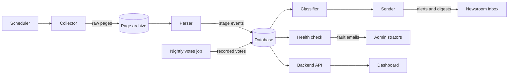

# Legislation Tracker (demo)

We built a legislation tracker for a newsroom as a UWA Industrial Project. The
system follows each bill through a state parliament, keeps a permanent record
of its steps, emails reporters when an important step happens, and gives them
a dashboard that suggests a few bills to check each day.

This repository holds a **portfolio demo** of that dashboard. You can click
through it as a reporter would, but we replaced the real data with made-up
data and took out the real names. The parts that collect, store and send are
not here.

**Live demo:** https://apratama23.github.io/legislation-tracker-demo/

> **Disclaimer.** This demo exists for portfolio purposes. We disguised the
> real data: the bills, members, votes, documents and text are fictional.
> Bills go by "Bill A", "Bill B" and so on, members by "Member A" onwards,
> parties by "Party 1" to "Party 4", and the text is filler. The numbers on the
> pages do not match the real system, and nothing here connects to a real
> parliament, organisation or database.

## The problem

Reporters at the newsroom followed bills by checking the parliament's website
by hand. The parliament publishes each bill's progress across scattered web
pages, with no data feed and no timetable. A bill can sit in a committee for
weeks and then move overnight, so a reporter cannot tell when to look, and a
step they find a day late is stale news. Checking several times a day costs
each reporter hundreds of hours a year, and on a busy day they can still miss
a step.

The tracker takes that job over. It checks the parliament every 30 minutes
and emails reporters the steps that matter. It also keeps a dated record of
each bill that reporters can search for stories about speed and delay, and a
short daily list that points them at the bills most worth a phone call.

## What the system does

- **Follows bills.** The collector reads the parliament's public bill pages
  through the day and records each step a bill takes: a reading, a committee
  referral, an amendment, Royal Assent, or an ending such as a lapse.
- **Keeps a permanent record.** The database stores each step with its date
  and the archived page it came from. A new record never overwrites an old one.
- **Alerts a newsroom.** Reporters get urgent movements by email within half
  an hour, and the rest in one digest each weekday morning.
- **Suggests bills worth a look.** The dashboard ranks a short list of bills
  to check each day, with one plain sentence on each.

## System parts



- **Scheduler.** Starts a collection cycle every 30 minutes from early morning
  to late evening. Each cycle collects, parses, classifies, sends the alerts
  that are due, and checks the system's health.
- **Collector.** Fetches the public bill pages. It follows the site's robots
  rules, waits several seconds between requests, and gives the site a contact
  address. It archives each page byte for byte in object storage before the
  parser reads it, and fetches a bill's own page only after that bill changes.
- **Parser.** Turns archived pages into stage events. It accepts a fixed list
  of known stage names and records anything else, or anything it cannot read,
  as a problem for a person to check. It does not guess. Because the archive
  keeps each page, a developer can fix the parser and re-read old pages
  without fetching them again.
- **Bill identity.** The parliament restarts bill numbers with each new
  parliament, so the system keys each bill on the permanent identifier the
  parliament gives it.
- **Nightly votes job.** Runs once a night, apart from the 30-minute cycle. It
  reads the published record of each sitting, takes out the recorded votes
  (divisions), and matches each printed name to the member roll. If it cannot
  read a name, it leaves that name blank and keeps the printed totals.
- **Database.** Keeps an append-only record. A correction adds a new record
  that points at the one it replaces, so you can see what the system knew on
  any earlier day. The database works out a bill's current status from its
  steps each time you read it, and stores no status of its own.
- **Classifier.** Sets the urgency of each new movement from a settings table
  that administrators edit.
- **Sender.** Emails urgent movements at once and gathers the rest into the
  morning digest. It retries failed sends, stops at a daily cap, and refuses a
  sudden flood of movements, since a flood points to a misread page more often
  than to a busy day.
- **Health check.** Measures the system against limits: time since the last
  collection, time since the collector last checked the robots rules, parse
  failures, unsent alerts, and alerts that ran out of retries. The dashboard
  shows "Working normally" or the fault in words, and an administrator can
  sign off a known fault with a note. The check runs every 10 minutes and
  emails administrators when something breaks, once a day while the fault
  lasts, and once more when the system recovers.
- **Backend API.** A read-only service that hands the dashboard what it shows:
  the feed, bills, votes, members, trends, health and the ranked list.
- **Dashboard.** The pages in this demo: Today, Bills, a page per bill, Votes,
  Members, Trends, Watching, System health, Settings and People. Each change an
  administrator makes on Settings goes into a history with who made it, when,
  and the old and new values.

In this demo, none of the collector, parser, database, sender, health check or
API runs. A script generated a fictional world, we rendered the pages from it
once, and this repository publishes the finished pages as static files. We
ranked the Worth a look list ahead of time.

## Change detection with hashing

The collector gives each fetched page two SHA-256 fingerprints: one of the raw
bytes, and one of the text left after it strips markup, spacing and other
noise.

| Raw hash | Text hash | Meaning | What the collector does |
|---|---|---|---|
| Same | Same | Nothing changed | Writes nothing new |
| Different | Same | Only the formatting changed | Archives the page and skips parsing |
| Different | Different | The content changed | Parses the list again and fetches each changed bill's own page |

On a quiet day the system writes nothing new, and the source site sees a
request for a bill's own page after that bill changes.

## Categories

Administrators sort bills into newsroom categories with keywords. The system
checks each keyword against bill titles: a keyword must start a word, and a
keyword of four letters or fewer must match a whole word, so "cat" finds a
Cat Bill and skips "education". A bill joins each category whose keyword it
matches. Editing a keyword updates all bills at once, and an administrator can
also set a bill's categories by hand.

## Alert tiers

An administrator gives each kind of movement a tier. A step can sit in one
tier in the chamber where the bill started and in another tier in the other
chamber.

- **Tier 1, immediate.** Its own email within half an hour, inside the hours
  set for urgent mail. A second reading agreed, a third reading and Royal
  Assent sit here by default.
- **Tier 2, daily digest.** One email each weekday morning that lists the
  bills that moved, with a short line per step.
- **Tier 3, record only.** The system keeps the movement and sends nothing.

Administrators keep two kinds of recipient list. People on the "Every alert"
list get each alert. People on a category's list get that category's urgent
alerts and a digest of their own categories, with a line saying which
category brought them the email. A person on several lists still gets one
email per alert, and no recipient sees another's address.

Each email leads with the bill's title, then what happened and when, the
bill's categories, a short synopsis and one link to the bill. Each also comes
with a plain-text version.

If the source corrects a date or withdraws a step that reporters already
received, the system sends one follow-up email naming the old and the new
state. It closes movements that sat unsent for too long instead of sending
stale news. It holds a movement until it knows the chamber where the bill
started, because the tier depends on that chamber, and it records a kind of
movement with no tier as a problem for a person to check.

In the demo you can change tiers, send times and recipients on Settings.
Nothing gets sent.

## Worth a look ranking

We keep the ranking engine private. In outline:

- **Reasons.** A bill before parliament can carry reasons to look at it: it
  had its first reading days ago, a committee reported on it, the houses are swapping
  amendments, members forced a recorded vote, it passed a house, it moved
  after a long silence, or it has waited far longer than usual.
  Administrators set a weight for each reason.
- **Fading.** A reason about an event loses weight as it ages, then stops
  counting. A reason about a state that still holds, such as a bill that is
  stuck, keeps its weight.
- **Colleagues.** Each colleague who follows a bill adds a little weight, up
  to a cap, and only to a bill that already has a reason.
- **Priority words.** An administrator types a word, and the ranking lifts
  bills whose title matches it above the rest, a few bills at a time.
- **Usual waits.** The engine estimates the usual wait at each stage with the
  Kaplan-Meier method. It counts a bill still waiting as "waited at least this
  long" instead of dropping it. Dropping those bills would measure the quick
  ones and make normal waits look shorter. The engine compares a bill against
  a stage once enough bills have passed through it.
- **Variety.** A few bills at most may lead with the same reason, and the
  bills that have waited longest fill any spare place.
- **No scores.** The dashboard shows the order and hides the score, because a
  number like 4.6 suggests more precision than the method has.

The Kaplan-Meier estimate of the chance a bill is still waiting after *t* days:

S(t) = ∏ (1 − dᵢ / nᵢ), over each day tᵢ ≤ t on which a bill moved on,

where dᵢ is the number of bills that moved on that day and nᵢ the number still
waiting at the start of that day.

Reference: Kaplan, E. L., & Meier, P. (1958). Nonparametric estimation from
incomplete observations. *Journal of the American Statistical Association*,
53(282), 457–481.

## Checking the system

We checked the real system four ways:

- **Automated tests** cover collection, parsing, storage, alerts, the
  dashboard and the ranking.
- **A data checker** runs a set of rules against the live database on each
  code push.
- **A weekly audit** has a person pick ten random bills and compare the stored
  steps with the parliament's own pages.
- **A ranking replay** reruns Worth a look for each past Monday, using the
  facts known on that day, to see what it would have suggested.

## Features

- **Today:** headline counts, Worth a look, where live bills are sitting, the latest recorded vote, and the day's movements.
- **Bills:** search, filters, sorting, category chips, a progress rail, and a side panel on wide screens.
- **Bill page:** status, a two-track journey through both chambers, synopsis, documents, votes, and each recorded step.
- **Votes:** the recorded divisions, with how each member voted.
- **Members:** each member's voting record and how often they sat on the winning side.
- **Trends:** time to become law, monthly activity, where bills are waiting, and the longest waits.
- **Watching:** the bills you follow, split by whether they moved recently.
- **System health:** collection runs, failures, alerts sent, retries, and each measure against its limit.
- **Settings:** alert tiers, send times, recipients, Worth a look settings, priority words, categories and keywords, and a history of changes.
- **People:** who can sign in, and their role.

## What the demo leaves out

- **Sign-in.** The sign-in screen has one button that enters the demo.
- **Email and collection.** The demo sends no email and reads no website.
- **Live ranking.** The demo checks and saves Worth a look settings but does
  not re-rank the list.
- **Shared saving.** Your browser keeps what you change (followed bills,
  settings, categories). **Reset demo** in the footer clears it.

## Run it locally

This repository holds the built site: plain HTML, CSS and JavaScript with no
build step. Serve the folder with a static web server, for example:

```bash
python -m http.server 8000
```

then open http://localhost:8000. You can also open `index.html` straight from
disk; browsers then limit what the page can save.
