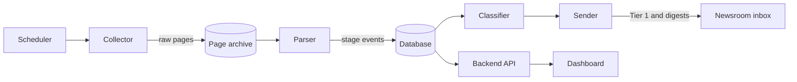

# Legislation Tracker (demo)

A legislation tracker built as a UWA Industrial Project. The real system
follows every bill through a state parliament, keeps a permanent record of
each step, emails a newsroom when something important moves, and gives
reporters a dashboard with a short daily list of bills worth a look.

This repository is a **portfolio demo** of that dashboard, made so the work
can be shown without exposing the real system. It looks and behaves like the
real dashboard, but the real data has been replaced with made-up data, the
real names have been removed, and the parts that collect, store and send are
not included.

**Live demo:** https://apratama23.github.io/legislation-tracker-demo/

> **Disclaimer.** This is a demo for portfolio purposes only. The real data is
> disguised: every bill, member, vote, document and piece of text here is
> fictional. Bills are called "Bill A", "Bill B" and so on, members are
> "Member A" onwards, parties are "Party 1" to "Party 4", and the text is
> filler. The numbers shown do not reflect the real system. Nothing here is
> connected to any real parliament, organisation or database.

## What the system does

- **Follows bills.** It reads the parliament's public bill pages through the
  day and notices every time a bill takes a step: a reading, a committee
  referral, an amendment, Royal Assent, or an ending such as a lapse.
- **Keeps a permanent record.** Every step is stored with its date and the
  page it was read from. Nothing is ever overwritten.
- **Alerts a newsroom.** Urgent movements are emailed within half an hour;
  the rest arrive in one digest each weekday morning.
- **Suggests bills worth a look.** Each day the dashboard ranks a handful of
  bills that a reporter might want to check, each with one plain sentence
  saying why.

## How the parts connect



- **Scheduler.** Runs a collection cycle every 30 minutes during the day.
- **Collector.** Fetches the public bill pages. It obeys the site's robots
  rules, waits between requests, and archives every page byte for byte in
  object storage before anything reads it.
- **Parser.** Turns archived pages into stage events. Anything it cannot read
  is recorded as a problem for a person to look at; it never guesses. Because
  every page is archived, a fixed parser can re-read old pages without
  fetching them again.
- **Database.** An append-only record. Nothing is deleted: a correction is a
  new record that points at the one it replaces, so you can always see what
  the system believed on any earlier day. A bill's current status is worked
  out from its steps when it is read, never stored.
- **Classifier.** Decides how urgent each new movement is, from a settings
  table that an administrator can change.
- **Sender.** Emails urgent movements at once and gathers the rest into one
  daily digest. It retries failed sends, stops at a daily cap, and has a
  circuit breaker that refuses a sudden flood of movements, since a flood is
  more often a page read wrongly than a day of real news.
- **Backend API.** A read-only service that gives the dashboard everything
  it shows: the feed, bills, votes, members, trends, system health and the
  ranked list.
- **Frontend dashboard.** The pages in this demo: Today, Bills, a page per
  bill, Votes, Members, Trends, Watching, System health, Settings and People.

**In this demo** the collector, parser, database, sender and API are not
present. A script generates a fictional world, the pages are rendered from it
once, and only the finished pages are published here as static files. The
Worth a look list is ranked ahead of time.

## Change detection with hashing

Every fetched page gets two SHA-256 fingerprints: one of the raw bytes, and
one of its text after normalising (markup, spacing and other noise removed).

| Raw hash | Text hash | Meaning | What happens |
|---|---|---|---|
| Same | Same | Nothing changed | Nothing more to do |
| Different | Same | Only formatting changed | Archived, not parsed again |
| Different | Different | The content changed | The list is parsed again, and each changed bill's own page is fetched |

This keeps the system polite to the source site: a bill's own page is only
fetched when something about that bill has actually changed.

## Alert tiers

Every kind of movement is given a tier, and a step can be judged differently
in the chamber a bill started in and in the other one.

- **Tier 1, immediate.** Its own email, sent within half an hour, during the
  hours set for urgent mail. A second reading agreed, a third reading or Royal
  Assent are typical.
- **Tier 2, daily digest.** Gathered into one email each weekday morning,
  listing every bill that moved, with a compact line for each step.
- **Tier 3, record only.** Kept in the record, never emailed.

The emails are plain and editorial: the bill's title is the largest thing on
the page, then what happened and when, the bill's categories, a short
synopsis, and one link to the bill. Every email also has a plain-text
version. People can follow categories and receive only the bills in them.

If a step that was already emailed turns out to be wrong (a date corrected, or
a step withdrawn by the source), the system sends **one follow-up email** that
says what changed, rather than quietly fixing the record.

In the demo, the alert tiers, send times and recipients can be changed on
Settings; nothing is sent.

## Worth a look: how it ranks

The real ranking engine is not part of this repository. In outline:

- Each bill before parliament can have **reasons** to be worth a look: it was
  just introduced, a committee reported on it, the houses are exchanging
  amendments, it went to a recorded vote, it passed a house, it started moving
  again after a long silence, it has been stuck far longer than usual, and so
  on. Each reason has a weight that an administrator can change.
- **News fades.** A reason about something that happened loses weight as it
  ages and eventually stops counting. A reason about a state that is still
  true, such as being stuck, does not fade.
- **Colleagues following** a bill add a little weight, up to a limit, and only
  to a bill that already has a reason.
- **Priority words.** An administrator can type a word; bills whose title
  matches it are lifted above everything else, a few at a time.
- **"Usual" waiting times** at each stage are estimated with the Kaplan-Meier
  method. A bill still waiting counts as "waited at least this long", instead
  of being left out. Leaving those bills out would only measure the quick
  ones and make every normal wait look shorter than it is. The estimate is
  only used where enough bills have passed through a stage.
- **The list is kept varied** (only a few bills may lead with the same reason)
  and always full; spare places go to the bills that have waited longest.
- **Scores are never shown.** The order says which bill comes first; a number
  would suggest more precision than the method has.

The Kaplan-Meier estimate of the chance a bill is still waiting after *t* days:

S(t) = ∏ (1 − dᵢ / nᵢ), over each day tᵢ ≤ t on which a bill moved on,

where dᵢ is the number of bills that moved on that day and nᵢ the number still
waiting just before it.

Reference: Kaplan, E. L., & Meier, P. (1958). Nonparametric estimation from
incomplete observations. *Journal of the American Statistical Association*,
53(282), 457–481.

## Features

- **Today:** headline counts, Worth a look, where live bills are sitting, the latest recorded vote, and the day's movements.
- **Bills:** search, filters, sorting, category chips, a progress rail, and a side panel on wide screens.
- **Bill page:** status, a two-track journey through both chambers, synopsis, documents, votes, and every recorded step.
- **Votes:** every recorded division, with how each member voted.
- **Members:** each member's voting record and how often they were on the winning side.
- **Trends:** time to become law, monthly activity, where bills are waiting, and the longest waits.
- **Watching:** bills you follow, split by whether they moved recently.
- **System health:** collection runs, failures, alerts sent, retries and every measure against its limit.
- **Settings:** alert tiers, send times, recipients, Worth a look settings, priority words, categories and keywords, and a history of every change.
- **People:** who can sign in, and their role.

## What the demo does not do

- No real sign-in: the sign-in screen has one button that enters the demo.
- No email is sent and nothing is collected from any website.
- The Worth a look list is pre-computed; changing its settings is checked and
  saved, but does not re-rank the list.
- Anything you change (following bills, settings, categories) is saved only in
  your own browser. **Reset demo** in the footer clears it.

## Run it locally

This repository holds the built site only: plain HTML, CSS and JavaScript,
with no build step. To view it, serve the folder with any static web server,
for example:

```bash
python -m http.server 8000
```

then open http://localhost:8000. Opening `index.html` straight from disk also
works for most pages, though browsers limit what a page opened that way can
save.
